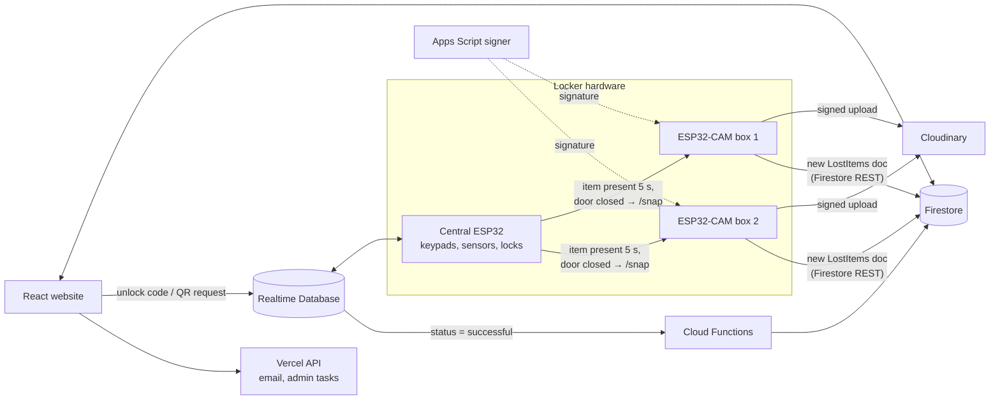
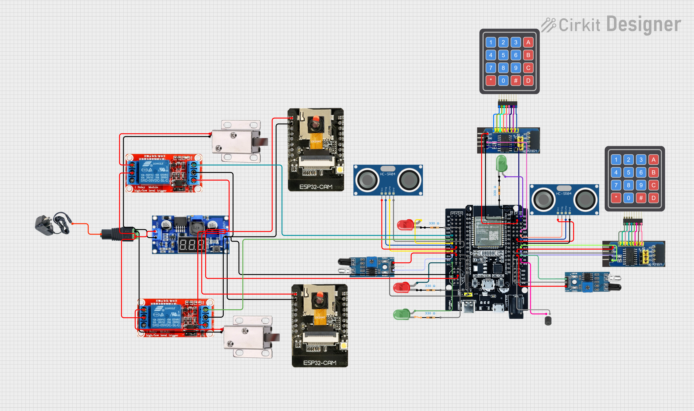

# ItemCloud – Smart Lost-and-Found Locker

**Gold Medal, International Creative Innovation Idea Competition (ICIIC) 2026** · Silver Medal, Karnival Inovasi@UMT 2025 · Silver Medal, InnoSTEM 2025

ItemCloud is an IoT lost-and-found locker for campuses. A finder drops a lost item into a locker box, a camera photographs it automatically, and the item appears on the website within seconds. The owner claims it online and opens the box with a one-time keypad code or a QR scan. No staff member has to be present.

**Live site:** [itemcloud-9a47f.web.app](https://itemcloud-9a47f.web.app) · **Backend API:** [ItemCloud-Backend](https://github.com/ngweibin050-dev/ItemCloud-Backend)

## How it works



1. **Drop-off.** The ultrasonic sensor sees an item and the IR sensor confirms the door is closed. After 5 seconds the central ESP32 asks that box's camera for one photo.
2. **Logging.** The ESP32-CAM fetches an upload signature from a Google Apps Script signer, uploads the photo to Cloudinary, and creates a `LostItems` record in Firestore. Item IDs (`I001`, `I002`, …) come from an atomic Firestore counter increment.
3. **Claim.** A signed-in student finds the item on the website and starts a claim. This writes an 8-character code (digits 0–9, letters A–D) with an expiry time to the Realtime Database.
4. **Unlock.** The student types the code on the box keypad, or scans the box's QR code. A correct code opens the solenoid lock for 10 seconds.
5. **Confirm.** The claim is marked **successful** only after the door opens and closes again and the box reads empty. A Cloud Function then writes the final claim record to Firestore and blocks the code from being reused. A scheduled function expires codes left unused for 5 minutes.

Admins can send a remote override unlock of 1–30 seconds, post updates, review reports and export data to Excel.

## Features

| Students | Admins |
| --- | --- |
| Browse lost items with photos, box and date | Dashboard with 9 charts (peak-hour heat map, monthly trends, time-to-claim, per-box leaderboard) |
| Claim an item and get a time-limited unlock code | Remote override unlock |
| Unlock by keypad or QR scan | Post updates, review profile edit requests and student reports |
| Claim history and in-app notifications | Export records to Excel |
| English / Malay interface | |

## Hardware



| Component | Qty | Role |
| --- | --- | --- |
| ESP32-WROOM (30-pin) + expansion board | 1 | Central controller for both boxes |
| ESP32-CAM (OV2640) | 2 | One camera per box |
| 4×4 keypad + PCF8574 I2C module | 2 | Code entry (two separate I2C buses) |
| HC-SR04 ultrasonic sensor | 2 | Detects whether an item is inside |
| MH-B IR obstacle sensor | 2 | Detects whether the door is closed |
| 12 V solenoid lock + 5 V relay module | 2 | Locks each box |
| Red/green LEDs, buzzer | 4 / 1 | Status and key-press feedback |
| LM2596 buck converter, 12 V barrel jack | 1 | Power |

Firmware details:
- Ultrasonic readings use a median of 3 samples with hysteresis (on at ≤19 cm, off at ≥20 cm) so the item state doesn't flicker.
- The door sensor is debounced (40 ms) and keypad presses are debounced (50 ms).
- Each attempt is logged to the database. The keypad shows live input to the website, and LEDs blink green or red on success or failure.
- Each device serves a local status page (`esp32-center.local`, `esp32-cam-1.local`) for debugging.

## Security

- **Role-based Firestore rules** ([`firebase/firestore.rules`](firebase/firestore.rules)) define five roles: signed-in user, the user themself, admin, anonymous camera device and the locker device account. Each collection limits which fields each role may change. For example:
  - A camera may only update a lost item's image URL and timestamps.
  - A claim can only be created when a matching successful claim attempt exists.
  - Admin action logs cannot be edited or deleted.
- **Realtime Database rules** ([`firebase/database.rules.json`](firebase/database.rules.json)) validate unlock-code format (`^[0-9A-D]{8}$`), attempt IDs and statuses, and cap admin override unlocks at 30 seconds.
- **Signed uploads:** the Cloudinary API secret stays inside the Apps Script signer, never on the device.
- **Credentials** are kept out of source code: the website reads `VITE_*` environment variables and the firmware reads a git-ignored `secrets.h`.

## Tech stack

| Layer | Technology |
| --- | --- |
| Website | React 19, Vite, Tailwind CSS, React Router, Recharts, i18next, html5-qrcode, SheetJS |
| Backend | Firebase Auth, Firestore, Realtime Database, Cloud Functions (Node 20), Firebase Hosting; Vercel serverless API ([ItemCloud-Backend](https://github.com/ngweibin050-dev/ItemCloud-Backend)) |
| Media and email | Cloudinary (signed uploads via Google Apps Script), EmailJS |
| Firmware | Arduino C++ on ESP32 / ESP32-CAM, Firebase ESP Client, I2CKeyPad, mDNS |

## Repository layout

```
src/
  pages/          Home, Lost Items, Claim History, Scan & Claim, Dashboard, Admin, auth flow
  components/     item cards, unlock modal, QR scanner, charts/
  services/       Firestore, Realtime Database, claims, notifications, admin
functions/        Cloud Functions: claim finalisation, code expiry
documentation/
  firmware/         ESP32 central controller and ESP32-CAM sketches
  firebase/         Firestore rules, Realtime Database rules, index definitions
  docs/             circuit diagram
```

## Run it locally

**Website**

```bash
npm install
cp .env.example .env.local   # fill in the values below
npm run dev                  # http://localhost:5173
```

Environment variables: `VITE_API_BASE_URL`, `VITE_CLOUDINARY_CLOUD_NAME`, `VITE_CLOUDINARY_PRESET`, `VITE_EMAILJS_PUBLIC_KEY`, `VITE_EMAILJS_SERVICE_ID`, `VITE_EMAILJS_TEMPLATE_ID`, `VITE_EMAILJS_UNLOCK_TEMPLATE_ID`, `VITE_APP_URL_MAIN`, `VITE_APP_URL_ALT`, `VITE_CAM`.

**Firebase**

1. Enable Email/Password and Anonymous sign-in.
2. Deploy rules and functions: `firebase deploy --only firestore:rules,database,functions`.
3. Create the composite indexes listed in [`firebase/firestore-indexes.md`](firebase/firestore-indexes.md).

**Firmware**

1. Open each folder in `firmware/` in the Arduino IDE (ESP32 board package).
2. Copy `secrets.example.h` to `secrets.h` and fill in your Wi-Fi, Firebase and Cloudinary values.
3. Flash `esp32_center` to the main board and `esp32_cam_1` / `esp32_cam_2` to the cameras (AI Thinker board).

## Known limitations

- One central controller serves two boxes; more boxes need another controller or more I/O.
- The ultrasonic sensor can miss flat or soft items lying below the beam.
- An OCR endpoint for reading student matric cards (Tesseract.js) exists in the backend but is not yet connected to sign-up.

## Team

Built by a team of six for ICIIC 2026 (Higher Institution Student category).

**My contribution (Ng Wei Bin):** _add the parts you built here, e.g. website, Firebase rules, ESP32 firmware._

## License

All rights reserved by the ItemCloud team.
